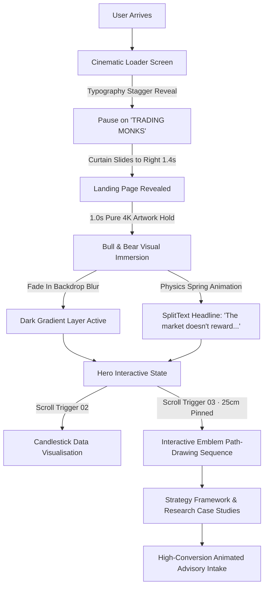

<div align="center">

  <!-- Brand Typography Animated Banner -->
  <a href="https://tradingmonks.com" target="_blank">
    
  </a>

  <p align="center">
    <strong>SEBI Registered Research Analyst · Registration No. INH000025027</strong><br />
    <em>Precision-driven thinking. Disciplined execution. An institutional perspective on financial markets.</em>
  </p>

  <!-- Shields & Badges -->
  <p align="center">
    
    
    
    
    
    
  </p>

  <p align="center">
    <a href="#-the-philosophy">The Philosophy</a> •
    <a href="#-architectural-workflow">Experience Journey</a> •
    <a href="#-key-features">Key Features</a> •
    <a href="#-tech-stack">Tech Stack</a> •
    <a href="#-project-structure">Structure</a> •
    <a href="#-quick-start">Quick Start</a> •
    <a href="#-compliance--statutory-disclosures">Compliance</a>
  </p>

  <br />

  <!-- Hero Preview Banner -->
  

</div>

<br />

---

## 🔱 The Philosophy

> **"The market doesn't reward the impulsive."**  
> Markets move. Emotions fluctuate. Our philosophy begins with an uncompromising commitment to structural geometry, volume participation, and risk awareness before capital is ever deployed.

| Pillar | Core Principle | Tactical Application |
| :--- | :--- | :--- |
| **01 · Structural Edge** | **Research** | Decisions informed by price geometry and institutional liquidity footprints, never speculative noise. |
| **02 · Systematic Calm** | **Discipline** | A non-negotiable process that neutralises greed and panic, maintaining consistency across volatility cycles. |
| **03 · Capital Preservation** | **Risk Awareness** | Strict invalidation boundaries and asymmetric payoff profiles defined explicitly before entry. |

<br />

---

## ⚡ Architectural Workflow

The Trading Monks web experience is engineered with cinematic choreography, ensuring users absorb institutional tranquility from their first interaction.



<br />

---

## ✨ Key Features & Engineering Highlights

### 1. 🎬 Cinematic Entrance & 1-Second Hold
* **Intro Loading Curtain**: Staggered letter reveal (`yPercent: 120 -> 0`, stagger `0.07s`) of "TRADING MONKS" over a rich obsidian screen, followed by a smooth `power4.inOut` horizontal slide uncover.
* **Pure 4K Visual Hold**: Upon curtain exit, the user is immersed in the raw 4K **Bull & Bear Standoff** wallpaper without visual clutter for **1 full second**.
* **Coordinated Text & Dark Layer Reveal**: After the 1-second hold, the cinematic dark vignette fades in smoothly, perfectly balancing background contrast while the typography animates into view.

### 2. 🔠 Physics-Driven SplitText Headline
* Powered by `@gsap/react` and `gsap/SplitText` with individual character wrapping (`charsClass: "split-char"`).
* **Spring-Physics Hover Lift**: Interactive cursor interaction using velocity-damped springs (`STIFFNESS: 180`, `DAMPING: 19`, `KICK: 0.024`) that lift characters dynamically as the user moves over the headline.
* **Golden Accents**: Dual-tone treatment pairing crisp ivory (`#FFFFFF`) with Monk Gold (`#D6B574`) and warm champagne highlights (`#F6E9C4`).

### 3. 🛡️ Section 03: 25cm Interactive Emblem Draw
* **Pinned Scroll Trigger**: Locked viewport (`pin: true`, height: `25cm`, end: `+=1800`, scrub: `0.7`) ensuring a zero-overlap, perfectly proportioned viewing experience.
* **SVG Path-Length Scroll Tracing**: As the user scrolls their mouse wheel, the geometric Trading Monks emblem draws stroke-by-stroke (`strokeDashoffset: 1 -> 0`), illuminating the monk's visor and golden awareness markers.
* **Progressive Principle Reveal**: The 3 philosophical pillars smoothly illuminate in sync with the emblem completion.

### 4. 📊 Procedural Candlestick Engine
* Pure SVG algorithmic market simulation mapping institutional price discovery vs erratic retail chop.
* Illustrative volume candles generated with deterministic mathematical curves (`Math.sin` + `Math.cos` harmonics) rendered with zero external chart library overhead.

### 5. 📬 Animated Advisory Consultation Hub
* Fully animated, responsive contact intake tailored for high-net-worth investors, family offices, and prop desk traders.
* Live form verification with client-side feedback and direct compliance disclosures.

<br />

---

## 🛠️ Tech Stack

<div align="center">

| Layer | Technologies | Role in Application |
| :--- | :--- | :--- |
| **Framework** | **Next.js 16.4.2 (Turbopack)** | Server/Client hybrid rendering, ultra-fast HMR, optimized asset pipeline |
| **Library** | **React 19.3.0** | Component model, Concurrent features, modern hooks (`useActionState`, `useId`) |
| **Animation Engine**| **GSAP 3.15 + ScrollTrigger + SplitText** | Frame-perfect scroll pinning, path drawing, staggered letter spring physics |
| **Language** | **TypeScript 5.x** | Complete end-to-end type safety and strict schema validation |
| **Styling** | **Custom Design System + Tailwind CSS v4** | Obsidian & gold tokenized CSS variables, glassmorphic filters, responsive typography |
| **Icons** | **Lucide React** | Feather-light SVG iconography |

</div>

<br />

---

## 📂 Project Structure

```bash
stock/
├── app/
│   ├── components/
│   │   ├── LoadingScreen.tsx    # Cinematic black curtain intro animation
│   │   └── LoadingScreen.css    # Staggered typography and slide transitions
│   ├── favicon.ico              # Monk emblem favicon
│   ├── layout.tsx               # Root layout, metadata, and font configurations
│   ├── page.tsx                 # Master single-page app (Sections 01 - 08)
│   └── page.css                 # Obsidian-Gold design system tokens & section styles
├── components/
│   ├── ui/
│   │   └── testimonial-card.tsx # Animated card component for investor testimonials
│   ├── SplitText.tsx            # React Bits GSAP SplitText with spring physics
│   └── testimonials-section.tsx # Interactive testimonials showcase
├── public/
│   ├── bull-bear-hero.png       # 4K Bull & Bear market standoff artwork
│   └── hero-bull-bear.jpg       # High-resolution backup image asset
├── package.json                 # Project dependencies & scripts
├── tsconfig.json                # Strict TypeScript configuration
└── README.md                    # Institutional documentation
```

<br />

---

## 🚀 Quick Start

### Prerequisites
* **Node.js**: `v20.x` or higher recommended
* **npm**: `v10.x` or **pnpm** / **yarn** / **bun**

### Installation

1. **Clone the Repository**
   ```bash
   git clone https://github.com/Harrsh777/Trading-Monks.git
   cd Trading-Monks
   ```

2. **Install Dependencies**
   ```bash
   npm install
   ```

3. **Launch the Development Server**
   ```bash
   npm run dev
   ```
   Open [http://localhost:3000](http://localhost:3000) in your browser to experience the animated sequence.

4. **Verify TypeScript & Production Build**
   ```bash
   npx tsc --noEmit
   npm run build
   ```

<br />

---

## 📜 Compliance & Statutory Disclosures

<div align="center">
  
</div>

<br />

### Research Analyst Information
* **Entity Name**: Trading Monks
* **Principal Research Analyst**: Manas Budhiraja
* **SEBI Registration Number**: `INH000025027`
* **Validity Period**: 16th February, 2026 – 15th February, 2031
* **Registered Office**: B Block, East of Kailash, New Delhi - 110065
* **Official Contact**:
  * ✉️ Email: [budhirajamanas23@gmail.com](mailto:budhirajamanas23@gmail.com)
  * 📞 Phone: [+91 9871861054](tel:9871861054)

<br />

<details>
<summary><strong>⚖️ Standard Statutory Regulatory Disclaimer (Click to expand)</strong></summary>

<br />

> *Registration granted by SEBI and certification from NISM in no way guarantee performance of the intermediary or provide any assurance of returns to investors. Investment in securities market are subject to market risks. Read all the related documents carefully before investing.*
>
> *Trading Monks does not offer guaranteed return schemes, profit sharing arrangements, or execution services. All research reports, technical commentary, and structural levels published are strictly for informational and educational purposes. Clients are advised to assess their individual risk appetite and consult their financial advisor prior to acting on research outputs.*

</details>

<details>
<summary><strong>🛡️ Investor Charter & Grievance Redressal Mechanism (Click to expand)</strong></summary>

<br />

In accordance with SEBI guidelines, investor grievances are resolved systematically:
1. **Level 1 (Direct Redressal)**: Reach out directly to [budhirajamanas23@gmail.com](mailto:budhirajamanas23@gmail.com) with complete trade details. All complaints are acknowledged within 48 business hours and resolved within 7 business days.
2. **Level 2 (SEBI SCORES Portal)**: If grievances remain unaddressed, investors may lodge complaints on SEBI's centralized portal: [https://scores.gov.in](https://scores.gov.in).
3. **Level 3 (SMART ODR Portal)**: Disputes may be escalated through online dispute resolution at [https://smartodr.in](https://smartodr.in).

</details>

<br />

---

<div align="center">
  <p>
    <sub>Designed with institutional precision · Built with Next.js, GSAP & React 19</sub><br />
    <strong>© 2026 TRADING MONKS. All Rights Reserved.</strong>
  </p>
</div>
